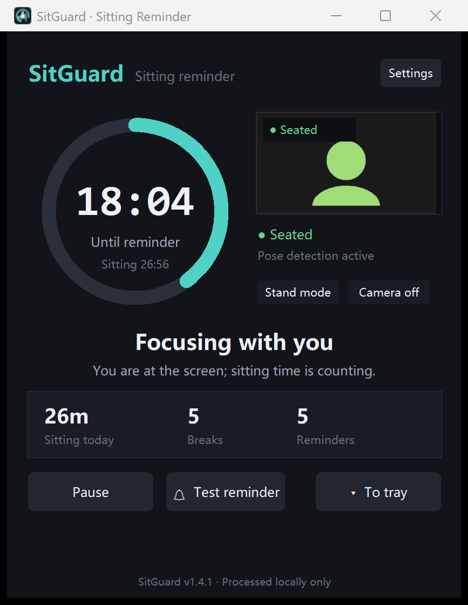
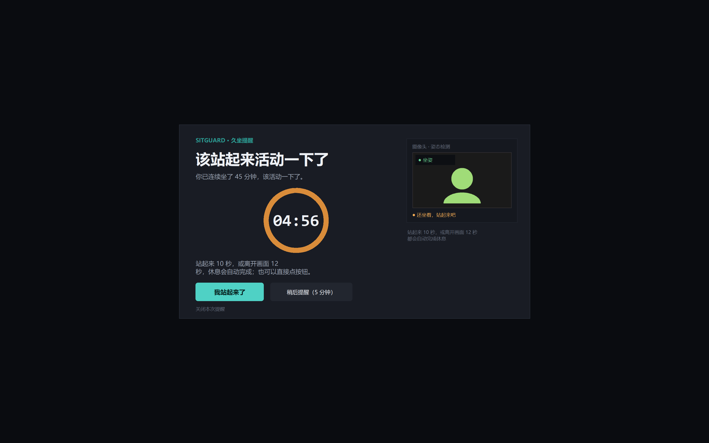

# SitGuard

A small Windows tray app that watches your webcam to tell whether you are
**sitting** at the screen. It starts timing when you sit down, reminds you to
stand up and move after 45 minutes of continuous sitting, and stops the clock
as soon as you stand.

[中文说明](README_ZH.md) · [Releases](https://github.com/Atumnsky/SitGuard/releases)



> Windows 10/11 · Python 3.13 · Camera frames are processed locally only —
> nothing is saved or uploaded.

## Features

- **Sit/stand detection** using MediaPipe Pose (33 landmarks) plus face and
  shoulder position, with an optional two-point calibration for your own
  camera angle and body size.
- **Smart timing** — only sitting time counts; standing pauses the timer.
- **45-minute reminder** — full-screen break overlay with a sound alert.
- **Break finishes when you stand** for 10 seconds, leave the frame for
  12 seconds, or click a button (instant).
- **3-minute rule** — standing for 3 minutes before the reminder restarts the
  sitting timer from zero.
- **Standing at the desk counts** — no need to walk away.
- **Bilingual UI** — 中文 / English, switchable instantly in Settings.
- **High-DPI ready** — per-monitor V2 awareness with crisp rendering on
  3.5K/200% displays.
- **Tray, autostart, daily stats**, single instance, fully local processing.
- **Camera auto-recovery** — if the feed stalls or the device drops after hours
  of running, a watchdog reconnects automatically; detectors are rebuilt hourly.



## Install from source

```bash
git clone https://github.com/Atumnsky/SitGuard.git
cd SitGuard
python -m pip install -r requirements.txt
python main.py
```

Requirements: **Windows 10/11** and **Python 3.13**. The face and pose models
are bundled in `models/`, so no extra downloads are needed. You can also
download the repository ZIP and double-click `StartSitGuard.vbs`.

## Calibrate once (recommended)

Camera angle and body size strongly affect posture detection. The calibration
records *your* sitting and standing profiles:

1. Open **Settings → Calibrate posture…**
2. Sit normally, click **Record sitting**, wait 2 seconds.
3. Stand the way you normally stand (it is fine to leave the frame),
   click **Record standing**, wait 2 seconds.
4. Click **Save calibration**.

If your standing pose is outside the frame, the app records “standing = out of
frame” and treats losing sight of you as standing up.

## Usage

- **Pause / Resume** — stop timing without quitting.
- **Test reminder** — preview the break overlay immediately.
- **Break overlay** — stand 10 s, leave the frame 12 s, click “I stood up”,
  or click “Close this reminder”.
- **Snooze** — postpone for 5 minutes.
- **Stand mode** — manual fallback if your camera angle defeats detection.
- **Tray** — closing the window keeps monitoring; right-click the tray icon
  to pause, take a break, toggle the camera, or quit.

## Settings

| Setting | Default | Description |
| --- | --- | --- |
| Remind after | 45 min | Popup after this much continuous sitting |
| Break duration | 5 min | Countdown length in the overlay |
| Reset sitting after away | 5 min | Sitting time resets after this absence |
| Finish break after standing | 10 s | Standing this long completes the break |
| Finish break when out of frame | 12 s | Leaving the frame also completes the break |
| Restart sitting after standing | 3 min | Standing this long restarts the sitting timer |
| Camera index | 0 | Try 1 for an external camera |
| Face detection sensitivity | 0.60 | Lower = more sensitive |
| Posture calibration | — | Record sitting/standing profiles |
| Language | 中文 | Chinese / English |

Config lives in `data/config.json` (git-ignored), daily stats in
`data/stats.json`.

## Tests

```bash
python -m unittest discover -s tests -p "test_engine.py" -v
```

Unit tests cover the timer state machine, posture heuristics, calibration
nearest-neighbour classification, out-of-frame handling and DPI scaling.
GitHub Actions runs them on every push.

## License and use

Copyright © 2026 Atumnsky. **All rights reserved.**

This repository is published as **source-available** for viewing and
reference only. No permission is granted to use, copy, modify, merge,
publish, distribute, sublicense, or sell copies of the software, in whole or
in part, without prior written permission from the copyright holder.

Third-party components and models remain under their own licenses and are
listed in [THIRD_PARTY_NOTICES.md](THIRD_PARTY_NOTICES.md).
