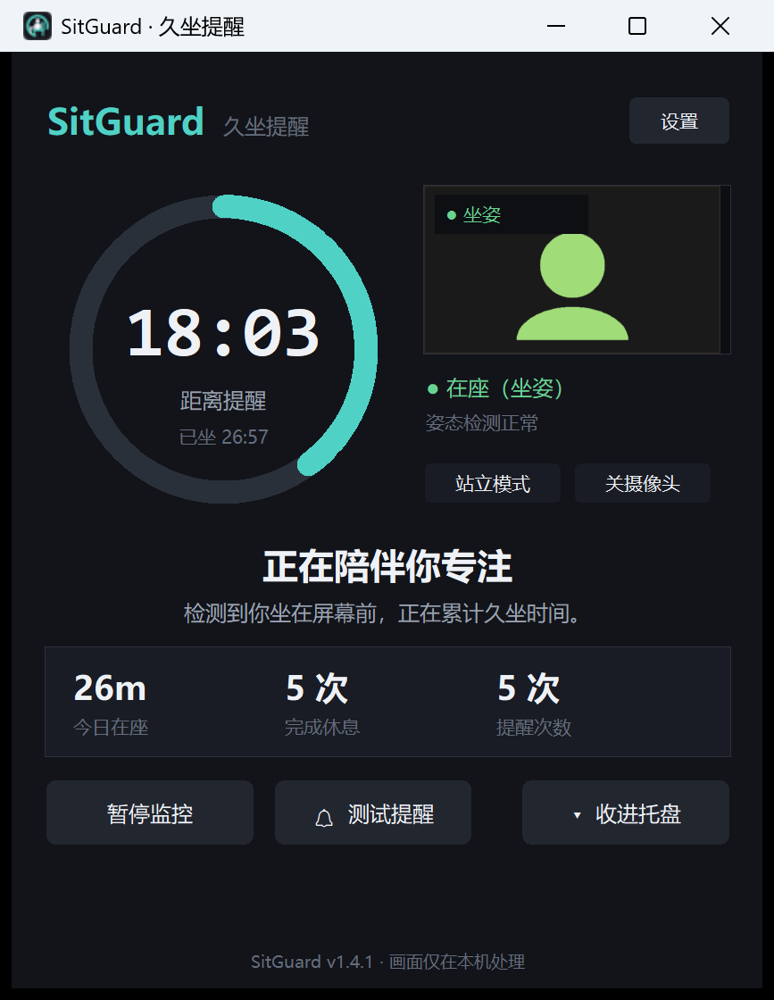
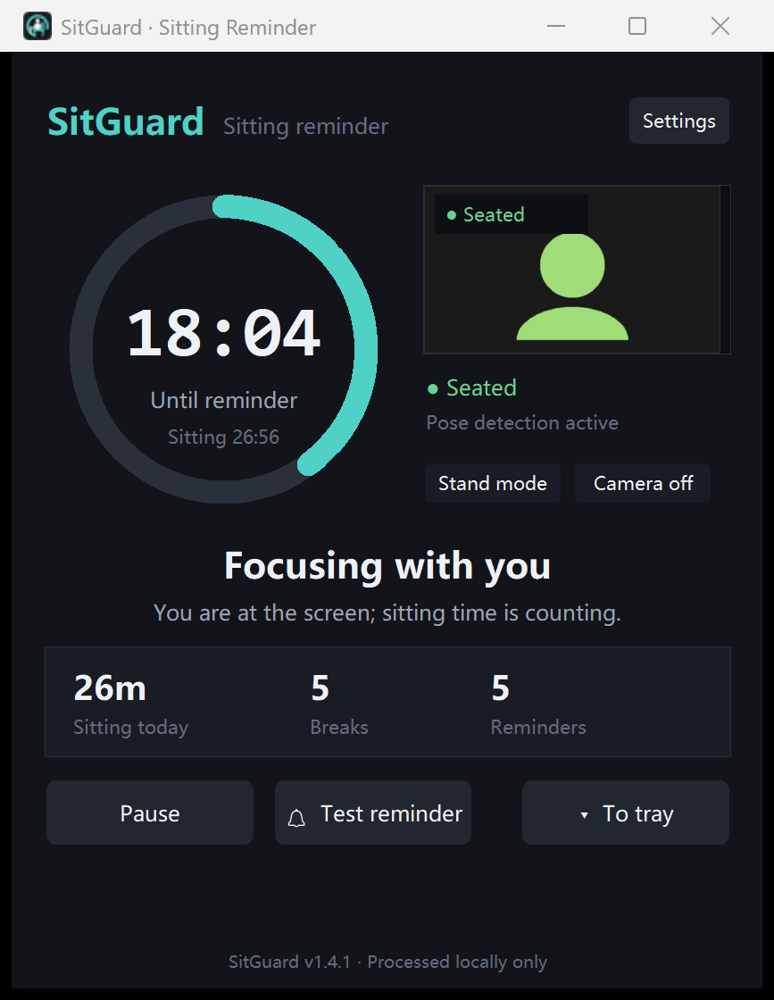
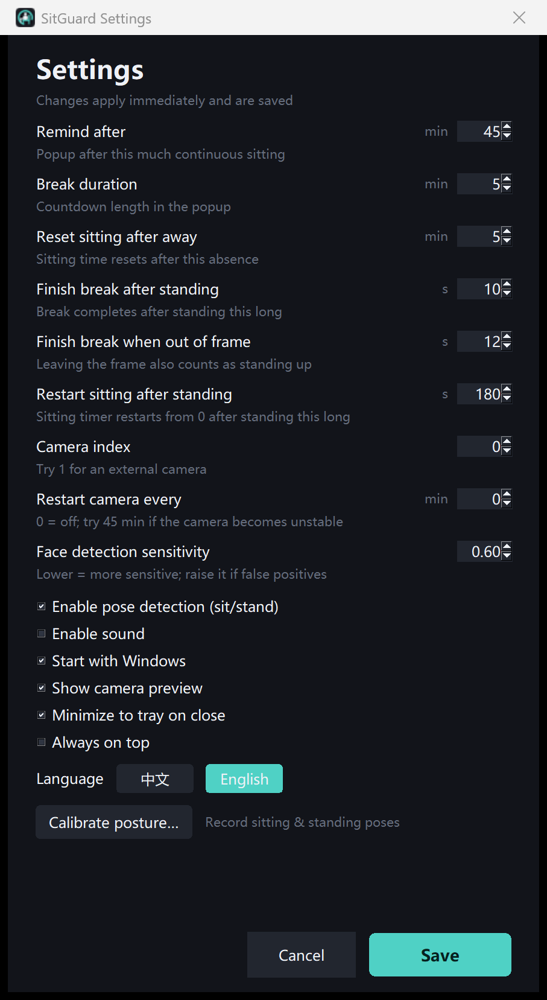
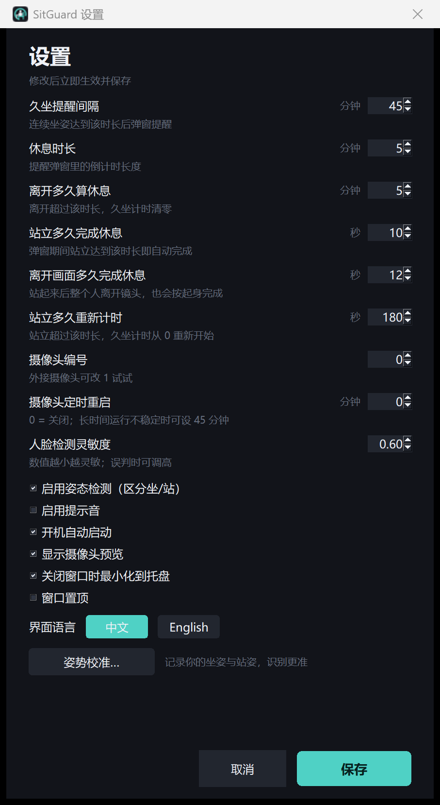
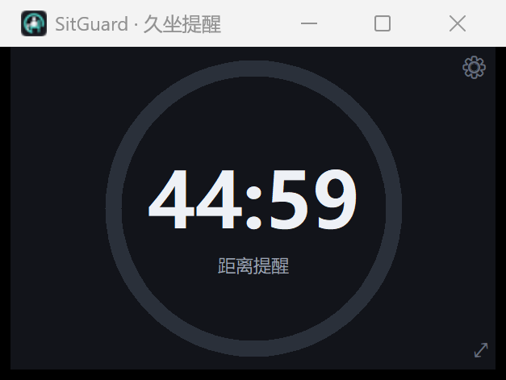
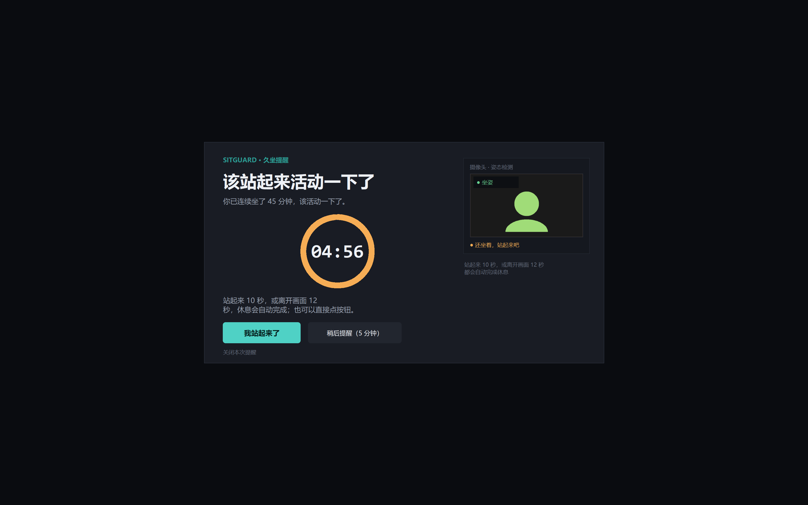

# SitGuard 久坐守护

一个常驻后台的小工具：用电脑摄像头判断你**坐**在屏幕前，
坐下自动计时，连续久坐 45 分钟后全屏提醒你站起来活动 5 分钟。
**站起来就停表**——站在桌前或离开镜头都算起身，弹窗也会很快自动关闭。

[](https://github.com/Atumnsky/SitGuard/actions/workflows/tests.yml)



> Windows 10/11 · Python 3.13 · 摄像头画面只在本机处理，不保存、不上传。
>
> [English README](README.md)

## 从源码安装

`ash
git clone https://github.com/Atumnsky/SitGuard.git
cd SitGuard
python -m pip install -r requirements.txt
python main.py
`

需要 **Windows 10/11** 与 **Python 3.13**；人脸/姿态模型已放在 models/，无需额外下载。
也可以直接下载仓库 ZIP，双击 StartSitGuard.vbs 启动。

## 快速开始

1. 双击 **`StartSitGuard.vbs`**（推荐，无控制台窗口）。
   首次运行若缺少依赖，会弹窗提示自动安装（需要联网，约 1–2 分钟）。
2. 建议先做一次 **姿势校准**（见下节），这是站立识别最可靠的方式。
3. 程序停在屏幕右上角；关闭窗口默认收进右下角托盘继续监控。
4. 想放桌面：双击 **`CreateDesktopShortcut.bat`**，之后从桌面 `SitGuard` 启动。

## 界面语言 / Language

界面支持 **中文** 与 **English**，切换立即生效，无需重启：
**设置 → 界面语言 → 中文 / English**。
主界面、休息弹窗、设置、托盘菜单与所有提示都会跟随语言。

English UI:




## 重要：先做一次姿势校准（强烈建议）

摄像头角度、椅子高度、你的身高都会影响判断。校准会记录你**真实**的坐姿和站姿：

1. 打开「设置」→ 点 **「姿势校准…」**；
2. 保持平时坐姿，点 **「记录坐姿」**，等 2 秒；
3. 站起来（平时站立的样子，**整个人离开镜头也可以**），点 **「记录站姿」**，等 2 秒；
4. 点 **「保存校准」**。

之后软件按你的实际画面特征判断，而不是用通用阈值。校准窗口里可以看到：
- 坐姿记录到“脸高 72%、肩高 87%”这类特征；
- 站姿如果看不到脸，会记录为“站姿＝离开画面”，之后看不到你就按起身处理。



## 它做什么

| 功能 | 说明 |
| --- | --- |
| 坐/站识别 | 校准档案 + MediaPipe 姿态（腿可见时看膝角）+ 脸部/肩部高度变化 |
| 智能计时 | **只有坐姿才累计**；站起来立刻停表，坐下继续 |
| 45 分钟提醒 | 到点弹出全屏休息窗 + 提示音（可关） |
| 起身自动完成 | 站立 10 秒，或整个人离开画面 12 秒 → 自动完成休息 |
| 立即关闭 | 「我站起来了」「关闭本次提醒」点一下立即结束，不再卡住 |
| 离开/站立重置 | 站立或离开超过 3 分钟，久坐计时从 0 重新开始 |
| 今日统计 | 今日累计在座、完成休息次数、提醒次数 |
| 托盘常驻 | 关闭窗口不退出；托盘菜单可暂停、立即休息、开关摄像头 |
| 摄像头自恢复 | 长时间运行后画面卡住/设备掉线时，看门狗自动重连；检测器每小时重建 |
| 雪花/黑屏检测 | 检测到电视雪花噪声或全黑画面，几秒内自动重启摄像头 |
| 定时重启 | 设置里可设“摄像头定时重启”分钟数（0=关闭），适合长时间运行不稳定的驱动 |
| 高 DPI | 适配 3.5K/200% 缩放，界面与文字原生清晰；跨不同缩放比例的屏幕时保持窗口逻辑尺寸 |
| 自由缩放 | 窗口可任意拖动缩放；缩到最小时只保留计时器，双击或点 ⤢ 恢复，尺寸自动记忆 |


| 开机自启 | 设置里勾选即可 |
| 隐私 | 画面只在本机内存处理，不保存、不上传 |



## 使用

- **暂停监控**：主界面「暂停监控」。
- **立即体验**：点「测试提醒」立刻弹出休息窗。
- **弹窗三种结束方式**：
  1. 站起来 10 秒（自动识别）；整个人离开画面 12 秒也会完成；
  2. 点「我站起来了」（立即结束）；
  3. 点「关闭本次提醒」（立即结束）。
- **稍后提醒**：推迟 5 分钟。
- **手动站立模式**：如果摄像头角度特殊、识别仍不准，点主界面的「站立模式」，
  软件会一直按站立处理、不累计久坐；再点「坐下」恢复自动识别。
- **收进托盘**：点「收进托盘」或关闭窗口；双击托盘图标重新打开。
- **退出**：托盘图标右键 →「退出」。

## 设置

| 设置项 | 默认 | 说明 |
| --- | --- | --- |
| 久坐提醒间隔 | 45 分钟 | 连续坐姿达到该时长后弹窗 |
| 休息时长 | 5 分钟 | 弹窗里的倒计时长度 |
| 离开多久算休息 | 5 分钟 | 超过该时长久坐计时清零 |
| 站立多久完成休息 | 10 秒 | 弹窗期间站立达到该时长自动完成 |
| 离开画面多久完成休息 | 12 秒 | 站起来后整个人离开镜头也算起身 |
| 站立多久重新计时 | 3 分钟 | 站立超过该时长，久坐计时从 0 重新开始 |
| 摄像头编号 | 0 | 外接摄像头可试 1、2 |
| 摄像头定时重启 | 0（关闭） | 长时间运行不稳定时可设 45 分钟 |
| 人脸检测灵敏度 | 0.60 | 数值越小越灵敏；误判多时调高 |
| 姿势校准 | — | 记录坐/站特征，识别最准 |
| 姿态检测 / 提示音 / 自启 / 预览 / 托盘 / 置顶 | — | 按需勾选 |

配置保存在 `data/config.json`，当天统计在 `data/stats.json`，日志在 `data/sitguard.log`。

## 判定逻辑

```
每 ~0.35 秒跑一次姿态模型（33 个关键点），并提取脸部/肩部特征
  0. 已校准：当前特征更接近坐姿档案 → 坐；更接近站姿档案 → 站
  1. 腿可见：髋-膝-踝夹角  伸直 >150° = 站；弯曲 <120° = 坐
  2. 髋、膝可见：髋部明显高于膝 = 站
  3. 只拍到上半身：比较“躯干长度 / 肩宽”相对坐姿基线的变化
  4. 肩部/脸部高度相对坐姿基线明显上移 → 站
  5. 看得到身体但看不到脸 → 站
  6. 站起来后整个人离开画面 → 按起身处理（校准时记录为“站姿看不到脸”）
状态切换有 2.5–3 秒迟滞；计时规则：
  坐姿 + 在座 → 累计；站立 → 停止累计；站立 ≥3 分钟 → 久坐从 0 重新计时
  久坐 ≥45 分钟 → 弹窗
  休息中：站立 ≥10 秒 / 离开画面 ≥12 秒 / 倒计时结束 / 手动确认 → 完成
```

## 常见问题

**1. 站立识别还是不准？**
先做一次 **姿势校准**（设置 → 姿势校准），这是针对你的摄像头角度和身高最有效的方法。
如果校准时站姿能看到脸，之后会按你的站姿特征判断；如果站姿整个人离开画面，
之后“看不到你”就会按起身处理。仍然特殊的情况用主界面「站立模式」。

**2. 弹窗关不掉？**
三种方式：站起来 10 秒自动关、点「我站起来了」立即关、点「关闭本次提醒」立即关。

**3. 提示“摄像头不可用”？**
确认摄像头没被会议软件占用；Windows「设置 → 隐私和安全性 → 相机」允许桌面应用访问；
在设置里换个「摄像头编号」再试。

**4. 界面还是有点糊？**
本版已开启 Per-Monitor V2 DPI 感知并按真实 DPI 缩放。如果从旧版升级，请完全退出旧进程
（托盘 → 退出）再重新启动；Windows 的“缩放”建议保持 150% 或 200%。

**5. 坐得远一点会被当成站立吗？**
已修复：坐远时脸变小、位置变化不会再判成站立；“看得到身体但看不到脸”也不再直接算站立。

**6. 托盘图标在哪？**
屏幕右下角任务栏的 `^` 展开区。右键有菜单，双击打开主界面。

## 技术说明

- Python 3.13 + tkinter（界面）+ OpenCV（采集）+ YuNet（人脸）+ MediaPipe Pose（姿态）
- 人脸每 ~0.2s、姿态每 ~0.35s 一次，CPU 占用低
- 高 DPI：Per-Monitor V2 + 全局 `dp()` 缩放 + Tk scaling
- 校准档案保存在 `data/config.json` 的 `calibration` 字段
- 单实例运行；重复启动会提示已在运行

```
SitGuard/
├─ StartSitGuard.vbs          启动器（无控制台，推荐）
├─ StartSitGuard-Console.bat  带控制台启动（排错）
├─ CreateDesktopShortcut.bat  创建桌面快捷方式
├─ main.py                    入口
├─ sitguard/
│  ├─ app.py                  主控制器 / 托盘 / 统计 / DPI / 校准
│  ├─ engine.py               计时状态机
│  ├─ posture.py              校准 + 坐/站判定
│  ├─ camera.py               采集 + 人脸 + 姿态
│  ├─ views.py                主界面 / 弹窗 / 设置 / 校准窗
│  ├─ presence.py             在场判定防抖
│  ├─ ui.py                   主题与 DPI 缩放
│  ├─ i18n.py                 中英文文案
│  ├─ autostart.py            开机自启
│  └─ sound.py                提示音
├─ models/                    YuNet + MediaPipe 姿态模型
├─ screenshots/               界面截图（200% 缩放实拍）
├─ tests/                     单元测试与集成测试
└─ tools/                     开发调试脚本
```

运行测试：

```
python -m unittest discover -s tests -p "test_engine.py" -v
```

## 版权与使用

Copyright © 2026 Atumnsky，**保留所有权利（All rights reserved）**。

本仓库仅以 **源码可见（source-available）** 形式公开，供查看与参考。
未经版权持有人事先书面许可，不得使用、复制、修改、合并、发布、分发、
再许可或出售本软件的全部或部分，也不得用于衍生作品。

第三方组件与模型仍适用其各自许可，详见
[THIRD_PARTY_NOTICES.md](THIRD_PARTY_NOTICES.md)。
